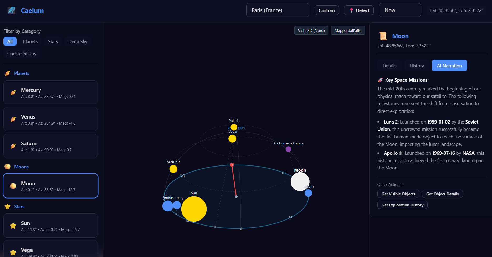

# Caelum Sky Observer & AI Agent

**Narrative and Intelligent Astronomical Observation Platform**

Caelum is a modern, enterprise-grade **microservices-based** astronomical observation platform that combines real-time altazimuth ephemeris calculations (powered by Skyfield and JPL ephemerides), a space exploration historical knowledge graph (Neo4j), a secure structured AI Agent orchestrator (LangChain + Google Gemini), and an interactive 3D celestial dome frontend (React + Vite + Three.js/Tailwind CSS).

---

## 🌌 1. Project Overview & UI Preview

Caelum bridges astronomical observation with space exploration history and AI-driven narrative storytelling. It is designed around strict domain constraints: **natural celestial bodies only** (no artificial satellites or space debris) and **structured agent interactions** (no free-text chat vulnerabilities; all interactions use validated schema actions).

### Screenshots / UI Preview
|                                            Main Observation Dashboard                                            |
|:----------------------------------------------------------------------------------------------------------------:|
|                                                       |
| *Interactive 3D alt-azimuth sky dome paired with a category-filtered sidebar (`planet`, `star`, `deep_sky`, `constellation`), observer coordinate & timestamp controls, and a real-time AI narration panel.* |

- **Sidebar & Filters**: Quick access to categorized visible celestial objects with altitude/azimuth badges.
- **3D Celestial Dome**: Immersive altazimuth dome rendering natural celestial bodies in real-time.
- **Narrative & History Panel**: Contextual storytelling combining real-time sky position with space exploration milestones from Neo4j.
- **Quick Actions**: Automated structured queries (`get_visible_objects`, `get_object_details`, `get_object_history`).

---

## 🏗️ 2. Architecture & Microservices

Caelum runs as a distributed microservices architecture orchestrated via Docker Compose.

```
┌─────────────────────────────────────────────────────────────────────────┐
│                       Client (React Frontend :3000)                     │
└────────────────────────────────────┬────────────────────────────────────┘
                                     │ HTTP REST (Structured JSON)
                                     ▼
┌─────────────────────────────────────────────────────────────────────────┐
│                caelum-api:8000 (API Gateway / Entry Point)              │
└─────────┬──────────────────────────┼──────────────────────────┬─────────┘
          │ GET /view                │ POST /action             │ POST /seed
          │ (3D Dome Coordinates)    │ (User Actions)           │ (Init DB)
          │                          ▼                          │
          │          ┌───────────────────────────────┐          │
          │          │       caelum-agent:8003       │          │
          │          │   ★ CENTRAL ORCHESTRATOR ★   │          │
          │          │   LangChain + Google Gemini   │          │
          │          └───────┬───────────────┬───────┘          │
          │                  │               │                  │
          │   Tool Calls     │               │     Tool Calls   │
          │ (/view, /object, │               │     (/history)   │
          │     /catalog)    │               │                  │
          ▼                  ▼               ▼                  ▼
┌──────────────────────────────┐           ┌──────────────────────────────┐
│     caelum-skyfield:8001     │           │       caelum-graph:8002      │
│     Astronomical Engine      │           │     Knowledge Graph API      │
│    (Skyfield + JPL de421)    │           └──────────────┬───────────────┘
└──────────────────────────────┘                          │ Cypher Query
                                                          ▼
                                           ┌──────────────────────────────┐
                                           │          neo4j:7687          │
                                           │       Space History DB       │
                                           └──────────────────────────────┘
```

### Microservices Summary

| Service | Container Name | Port | Tech Stack | Role & Responsibilities |
| :--- | :--- | :--- | :--- | :--- |
| **Frontend** | `caelum_frontend` | `3000` (`80` inside) | React, Vite, Tailwind CSS, Nginx | Interactive dashboard, 3D celestial dome, sidebar filters, narrative panel. |
| **API Gateway** | `caelum_api_gateway` | `8000` | Python, FastAPI, Requests | Single entry point, request proxying, CORS middleware, system health aggregation. |
| **Skyfield Engine** | `caelum_skyfield` | `8001` | Python, FastAPI, Skyfield, NumPy | Calculates real-time altazimuth coordinates, altitude/azimuth, visibility, and celestial catalog. |
| **Graph Service** | `caelum_graph` | `8002` | Python, FastAPI, Neo4j Driver | Manages space exploration history graph (missions, probes, agencies, events) and Cypher queries. |
| **AI Agent** | `caelum_agent` | `8003` | Python, FastAPI, LangChain, Google Gemini | Structured action orchestrator (`get_visible_objects`, `get_object_details`, `get_object_history`) with deterministic fallback. |
| **Database** | `caelum_neo4j_db` | `7474`, `7687` | Neo4j 5.23 Community | Graph database storing historical space exploration entities and relationships. |
| **Cache** | `caelum_redis` | `6379` | Redis Alpine | High-performance caching layer. |

---

## ⚙️ 3. Prerequisites & Environment Variables

### Prerequisites
- [Docker](https://www.docker.com/) & [Docker Compose](https://docs.docker.com/compose/) (v2.0+)
- [Google Gemini API Key](https://aistudio.google.com/) (required for `caelum-agent`)

### Environment Configuration (`.env`)
Create a `.env` file in the project root directory:

```env
# Google Gemini API Key (Required for AI Agent narration)
GOOGLE_API_KEY=your_google_gemini_api_key_here

# Neo4j Database Credentials
NEO4J_USER=neo4j
NEO4J_PASSWORD=caelum_password

# Internal Service URLs (defaults for Docker Compose network)
SKYFIELD_URL=http://caelum-skyfield:8001
GRAPH_URL=http://caelum-graph:8002
AGENT_URL=http://caelum-agent:8003
```

---

## 🚀 4. Quick Start & Seeding the Knowledge Graph

### Step 1: Clone and Start Containers
```bash
git clone https://github.com/your-username/caelum-sky-observer-agent.git
cd caelum-sky-observer-agent
cp .env.example .env  # Add your GOOGLE_API_KEY
docker compose up -d --build
```

### ⚡ Step 2: Seed the Neo4j Knowledge Graph (CRITICAL)
Right after starting the containers for the first time, you must initialize the Neo4j knowledge graph with historical space exploration data (missions, probes, celestial bodies, and agencies). Run the following `curl` command:

```bash
curl -X POST "http://localhost:8000/api/v1/sky/seed" \
  -H "Content-Type: application/json" \
  -d "{}"
```

*Verification:* You should receive a JSON response confirming successful seeding (`"success": true`).

---

## 📡 5. HTTP API Reference & `curl` Examples

All client requests must go through the **API Gateway (`http://localhost:8000`)**.

### 1. Health Check
Checks the operational status of the API Gateway and all underlying microservices.

```bash
curl "http://localhost:8000/health"
```

**Response Example (`200 OK`):**
```json
{
  "status": "healthy",
  "gateway": "healthy",
  "services": {
    "skyfield": true,
    "graph": true,
    "agent": true
  },
  "timestamp": "2026-06-06T12:00:00.000Z"
}
```

---

### 2. Seed Knowledge Graph
Populates Neo4j with space exploration history.

```bash
curl -X POST "http://localhost:8000/api/v1/sky/seed" \
  -H "Content-Type: application/json" \
  -d "{}"
```

**Response Example (`200 OK`):**
```json
{
  "success": true,
  "data": {
    "status": "success",
    "message": "Knowledge graph seeded successfully"
  },
  "timestamp": "2026-06-06T12:00:00.000Z"
}
```

---

### 3. Get Visible Sky Objects
Calculates visible celestial bodies for a given observer location and timestamp.

```bash
curl "http://localhost:8000/api/v1/sky/view?lat=41.9028&lon=12.4964"
```

**Response Example (`200 OK`):**
```json
{
  "success": true,
  "observer": {
    "latitude": 41.9028,
    "longitude": 12.4964,
    "timestamp": "2026-06-06T12:00:00.000Z"
  },
  "visible_objects": [
    {
      "name": "Sun",
      "category": "planet",
      "altitude_degrees": 45.2,
      "azimuth_degrees": 180.5,
      "visible": true
    },
    {
      "name": "Mars",
      "category": "planet",
      "altitude_degrees": 28.4,
      "azimuth_degrees": 115.2,
      "visible": true
    }
  ]
}
```

---

### 4. Execute AI Agent Actions (Structured Input)
The AI agent (`caelum-agent`) exposes a strict structured-input endpoint (`/api/v1/sky/action`) supporting 3 predefined actions.

#### Action A: `get_visible_objects` (Panorama narration)
```bash
curl -X POST "http://localhost:8000/api/v1/sky/action" \
  -H "Content-Type: application/json" \
  -d '{
    "action": "get_visible_objects",
    "latitude": 41.9028,
    "longitude": 12.4964,
    "include_planets": true,
    "include_stars": true
  }'
```

#### Action B: `get_object_details` (Celestial body position & narrative)
```bash
curl -X POST "http://localhost:8000/api/v1/sky/action" \
  -H "Content-Type: application/json" \
  -d '{
    "action": "get_object_details",
    "latitude": 41.9028,
    "longitude": 12.4964,
    "object_name": "Mars"
  }'
```

#### Action C: `get_object_history` (Space exploration history from Neo4j)
```bash
curl -X POST "http://localhost:8000/api/v1/sky/action" \
  -H "Content-Type: application/json" \
  -d '{
    "action": "get_object_history",
    "latitude": 41.9028,
    "longitude": 12.4964,
    "object_name": "Moon"
  }'
```

**Response Example (`200 OK` for Agent Actions):**
```json
{
  "success": true,
  "action": "get_object_history",
  "object_name": "Moon",
  "narrative": "The Moon has been the primary milestone of human space exploration, famously reached by Apollo 11 in July 1969...",
  "data": {
    "missions": [
      {"name": "Apollo 11", "agency": "NASA", "year": 1969},
      {"name": "Artemis I", "agency": "NASA", "year": 2022}
    ]
  },
  "timestamp": "2026-06-06T12:00:00.000Z"
}
```

---

## 📁 6. Project Structure

```
caelum-sky-observer-agent/
├── docker-compose.yml                     # Microservices orchestration
├── README.md                               # Project documentation
├── .env.example                            # Environment variables template
├── .gitignore                              # Git exclusion rules
├── docs/
│   └── images/                             # UI screenshots & diagrams
│       ├── ui-dashboard.png
│       └── ui-dome-3d.png
└── services/
    ├── frontend/                           # React + Vite + Tailwind frontend
    │   ├── Dockerfile
    │   ├── nginx.conf
    │   ├── package.json
    │   └── src/
    │       ├── App.jsx
    │       ├── components/                 # Dome3D, Header, CelestialSidebar, StoryPanel
    │       └── utils/
    ├── caelum-api/                         # API Gateway (Port 8000)
    │   ├── Dockerfile
    │   ├── requirements.txt
    │   └── app/
    │       └── main.py
    ├── caelum-skyfield/                    # Astronomical Engine (Port 8001)
    │   ├── Dockerfile
    │   ├── requirements.txt
    │   └── app/
    │       ├── main.py
    │       ├── engine.py
    │       └── data/                       # Ephemerides (*.bsp) & catalog
    ├── caelum-graph/                       # Knowledge Graph Service (Port 8002)
    │   ├── Dockerfile
    │   ├── requirements.txt
    │   └── app/
    │       ├── main.py
    │       └── service.py
    └── caelum-agent/                       # AI Agent Service (Port 8003)
        ├── Dockerfile
        ├── requirements.txt
        └── app/
            ├── main.py
            ├── agent.py
            └── tools.py
```

---

## 🛡️ Core Domain Guardrails

1. **Natural Celestial Bodies Only**: Excludes all artificial satellites, space stations (e.g., ISS), and orbital debris.
2. **Structured Inputs Only**: Eliminates prompt-injection and free-text vulnerabilities by requiring strict JSON action schemas.
3. **Visibility Guardrails**: Historical space exploration context is only queried and narrated for celestial bodies currently verified as visible above the observer's local horizon.
